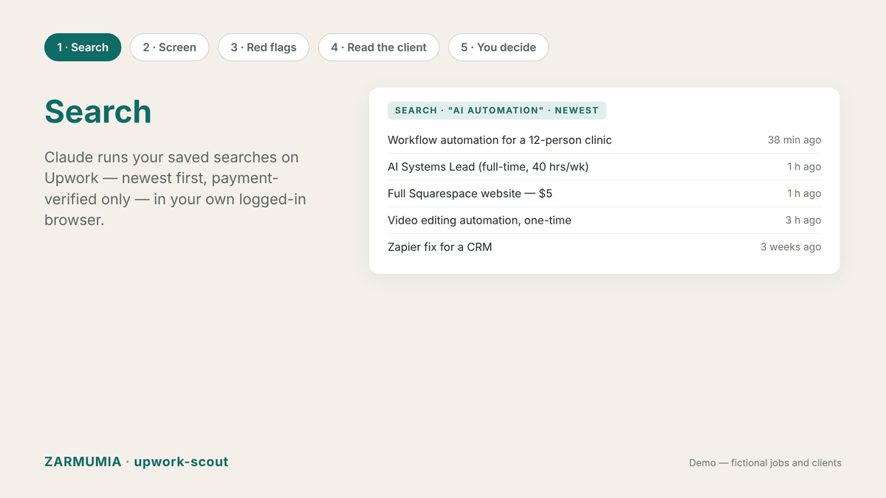

# upwork-scout

**Upwork has great clients — buried under a lot of noise. This finds them.**

A Claude skill for freelancers on Upwork.
Claude searches fresh jobs in your own logged-in browser, screens them against your criteria, catches the red flags, reads the client's history, and brings back a short list.
**You decide and you write every proposal.** Nothing is ever sent automatically.

## Why a human decides — always

1. **Fit is a judgment call.** Criteria are a first screen. A job that passes every filter can still be wrong for you, and a job that misses one can be exactly right. The agent shows; you choose.
2. **Your proposal is your voice.** The person who writes the proposal is the person the client will hire. No gap between the two.
3. **Connects are money.** Nothing gets spent without you.

## How it works

1. **Search**: Claude runs your saved queries, newest first, payment-verified only.
2. **Screen**: freshness, client rating, client spend, competition, project vs. long-term, your hard no's.
3. **Red flags**: catches free-labor and rating-farming accounts (100+ jobs, tiny total spend, $5 "websites", all-5.0 reviews on tiny jobs).
4. **Read the client**: past reviews, what they value, what went wrong before.
5. **Shortlist**: up to 3 jobs, each with why it fits, what to check, and any filter it misses. Zero is a valid result.
6. **You decide**: apply yourself. Ask for a draft if you want one.
7. **Log**: every job reviewed goes to `job-log.csv`. Once a week: applied → viewed → replied → interview → hired.

After a few weeks you know which searches bring jobs worth applying to.

## Setup

1. Copy `config.example.yaml` to `config.yaml` and fill in who you are, your searches, filters and hard no's.
2. Use the skill with Claude in Chrome (logged in to Upwork) and say: **"upwork round"**.
3. Optional: run it as a daily scheduled task.

## Files

| File | What it is |
|---|---|
| `SKILL.md` | The method: screening, red flags, hard limits |
| `config.example.yaml` | Your profile, searches, filters, hard no's |
| `job-log.csv` | Every job reviewed, and what came of it |
| `examples/` | Real screening decisions and the lessons behind them |
| `media/` | Demo GIF |

---

## בעברית

**ב־Upwork יש לקוחות מצוינים, קבורים מתחת להרבה רעש. הכלי הזה מוצא אותם.**

סקיל ל־Claude לפרילנסרים ב־Upwork.
Claude מחפש משרות טריות בדפדפן שלך, שבו את כבר מחוברת, ומסנן אותן לפי הקריטריונים שלך. הוא מזהה דגלים אדומים, קורא את ההיסטוריה של הלקוח ומביא רשימה קצרה.
**את מחליטה ואת כותבת כל הצעה.** שום דבר לא נשלח אוטומטית.

**הזרימה:** מחפשים ← מסננים ← מזהים דגלים אדומים ← קוראים את הלקוח ← רשימה קצרה ← את מחליטה ← נרשם ביומן.

**למה תמיד אדם:**
1. **התאמה היא שיקול דעת.** הקריטריונים הם רק סינון ראשון. משרה שעוברת הכול עדיין יכולה לא להתאים, ומשרה שנופלת בקריטריון אחד יכולה להתאים בדיוק.
2. **ההצעה היא הקול שלך.** מי שכותבת את ההצעה היא מי שהלקוח מעסיק.
3. **Connects הם כסף.** שום דבר לא יוצא בלי אישור שלך.

---

Built by [Zarmumia](https://zarmumia.co.il). The repo is free.

License: MIT
